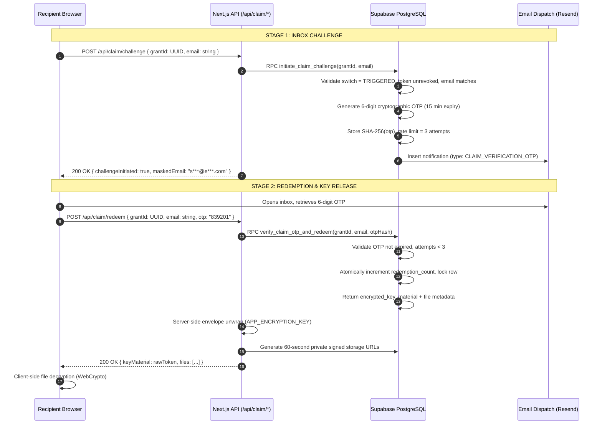
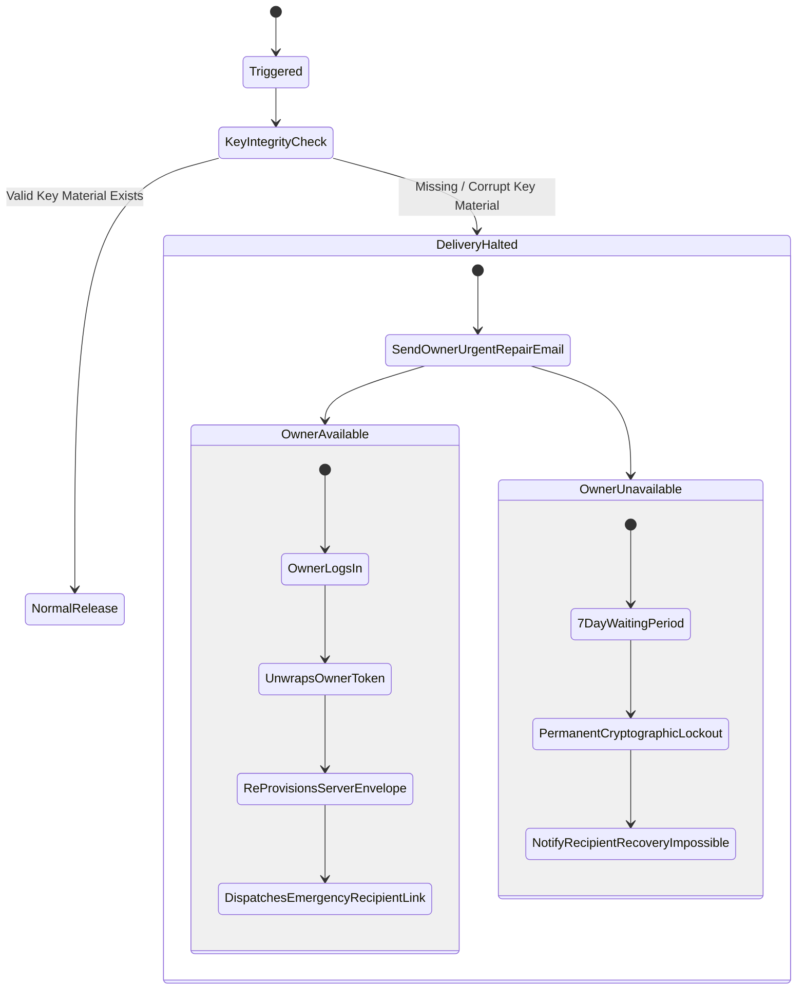

# DESIGN B FINAL REVIEW & ARCHITECTURAL SPECIFICATION
## Server-Side Envelope Encryption & Zero-Knowledge Cryptographic Hardening

**Document Version:** 3.0.0 (Final Architecture Review)  
**Status:** PLANNING ONLY — NO CODE, DATABASE, OR ENVIRONMENT MUTATIONS  
**Date:** 2026-11-04  
**Project:** DEAD MAN SWITCH (`c:\Users\ASUS\Desktop\DEAD MAN BRO`)  

---

## 1. Executive Summary & Security Boundary Definition

### 1.1 Objective & Context
This document defines the final, production-grade architectural specification for **Design B**. It addresses the complete threat model of the Dead Man's Switch, resolving critical cryptographic weaknesses identified in the baseline codebase, including:
1. The catastrophic exposure of `key_material` plaintext in the database.
2. The pseudo-cryptographic reliance on `user.id` with a static salt for owner vault encryption.
3. The lack of genuine recipient email inbox verification during claim redemption.
4. Database race conditions, indeterminate token selection, and redemption replay risks.

### 1.2 Explicit Security Boundary & Threat Model Scope (Requirement 11)

```
┌────────────────────────────────────────────────────────────────────────┐
│ WHAT THIS ARCHITECTURE PROTECTS AGAINST                                │
├────────────────────────────────────────────────────────────────────────┤
│ ✓ Stolen Database / Storage Backups: An attacker with full SQL dumps,  │
│   WAL logs, or Supabase Storage blobs cannot decrypt payload files.    │
│ ✓ Passive Database Compromise: SQL injection or read-only database     │
│   compromise yields only encrypted DEKs and encrypted key envelopes.   │
│ ✓ Storage Bucket Public Exposure: Ciphertext blobs remain AES-256-GCM  │
│   encrypted under independent, high-entropy per-file DEKs.             │
│ ✓ Rogue Database Administrators: DB admins cannot read recipient keys  │
│   or owner vault keys without the external application environment key.│
│ ✓ Recipient Email String Guessing: Claim redemption requires proof of  │
│   inbox possession via a time-limited OTP challenge.                  │
└────────────────────────────────────────────────────────────────────────┘

┌────────────────────────────────────────────────────────────────────────┐
│ WHAT THIS ARCHITECTURE DOES NOT PROTECT AGAINST (APPLICATION BOUNDARY) │
├────────────────────────────────────────────────────────────────────────┤
│ ✗ Compromised Application Server Runtime: An attacker who achieves     │
│   Remote Code Execution (RCE) on the Next.js production server or      │
│   access to server environment variables has custody of                │
│   APP_ENCRYPTION_KEY and can unwrap active recipient tokens upon claim.│
│ ✗ Malicious Application Code: If the Next.js server code is modified   │
│   to intercept, log, or forward decrypted keys during the /api/claim   │
│   exchange, the server can harvest keys as recipients claim them.      │
│ ✗ Compromised Client Browser / Malicious Extension: An attacker with   │
│   DOM/JS execution rights in the browser can exfiltrate keys while     │
│   they exist in WebCrypto memory during active upload or download.     │
└────────────────────────────────────────────────────────────────────────┘
```

---

## 2. Cryptographic Hardening: Owner Master Vault Key (Requirement 1)

### 2.1 The Vulnerability in Current Baseline
In [`create/page.tsx:108`](file:///c:/Users/ASUS/Desktop/DEAD%20MAN%20BRO/src/app/dashboard/create/page.tsx#L108) and [`[id]/page.tsx:284, 358, 428`](file:///c:/Users/ASUS/Desktop/DEAD%20MAN%20BRO/src/app/dashboard/%5Bid%5D/page.tsx#L284), the owner's Key Encryption Key (KEK) is derived as:
```typescript
const ownerKek = await deriveKEK(user.id, 'owner-vault-salt');
```
**Severity: Critical Cryptographic Weakness.**  
`user.id` is the public Supabase Auth UUID (present in client JWTs, database foreign keys, and audit logs). `'owner-vault-salt'` is a static, publicly visible string. Anyone with read access to the `files` table can immediately compute `ownerKek` with zero secret knowledge and unwrap all `encrypted_dek_owner` values.

### 2.2 The Owner Vault Architecture: Master Passphrase + Random Vault Salt
Owner encryption must be derived from an independent, client-side secret factor that is **never transmitted to the server or database in plaintext**.

```
Owner Master Passphrase (client input only)
                 │
                 ▼
       Argon2id or PBKDF2-SHA512 (600,000 iterations)
                 │
                 ├─► Salt: Unique random 32-byte salt stored in public.profiles.vault_salt
                 │
                 ▼
          Owner Master KEK (AES-256-GCM, extractable = false in WebCrypto)
                 │
                 ├─► Wraps/Unwraps per-file DEKs (encrypted_dek_owner)
                 ├─► Wraps/Unwraps recipient delivery token (encrypted_token_owner)
                 └─► Encrypts an Owner Master Recovery Key (OMRK) envelope
```

### 2.3 Creation & Onboarding Flow
1. **Initial Registration:** Upon account creation, the user creates an **Owner Vault Passphrase** (distinct from their Supabase login password, or derived via client-side SRP/PBKDF2 before login hashing).
2. **Salt Generation:** The browser generates a cryptographically random 32-byte salt:
   ```typescript
   const vaultSalt = bufferToHex(crypto.getRandomValues(new Uint8Array(32)));
   ```
   Stored in `public.profiles.vault_salt`.
3. **Master KEK Derivation:**
   ```typescript
   const masterKek = await deriveOwnerMasterKEK(passphrase, vaultSalt);
   ```
4. **Recovery Kit Generation:** The browser generates a 128-bit high-entropy Recovery Code (formatted as 24 BIP-39 mnemonic words).
   - The recovery code derives a `recoveryKek`.
   - A random 256-bit `vault_unlock_key` is generated: wrapped with `masterKek` (stored as `vault_key_envelope_primary`) and wrapped with `recoveryKek` (stored as `vault_key_envelope_recovery`).
   - The user is forced to download or verify their 24-word emergency recovery kit.

### 2.4 Session Memory & Caching Lifecycle
- `masterKek` lives exclusively in browser memory (React state / WebCrypto non-extractable `CryptoKey` object) during an authenticated session.
- **Auto-lock:** After 15 minutes of inactivity or upon browser tab closure (`sessionStorage` only, wiped on `unload`), the vault locks. The owner must re-enter their passphrase to perform operations requiring the owner KEK (uploading new files, editing secrets, rotating keys).
- **Zero Server Exposure:** The passphrase and `masterKek` are **never** included in HTTP requests to Next.js or Supabase.

### 2.5 Passphrase Change & Lost Secret Behavior
- **Passphrase Change:** With the existing session unlocked, the user provides their current passphrase and new passphrase. The browser unwraps `vault_unlock_key` with the old KEK, derives the new KEK with a new random `vault_salt`, re-wraps `vault_unlock_key`, and saves the new envelope. Payload files do not need re-encryption.
- **Lost Passphrase Recovery:** User inputs their 24-word recovery mnemonic. The browser derives `recoveryKek`, unwraps `vault_unlock_key`, prompts for a new passphrase, re-wraps the primary envelope, and updates the database.
- **Unrecoverable Secret (Lost Passphrase + Lost Recovery Kit):** If both are lost, the owner's personal access to encrypted files is **permanently lost by design** (zero-knowledge guarantee). However, **recipient delivery is unaffected**: the recipient's ability to claim and decrypt files depends entirely on `encrypted_key_material` (server envelope) and recipient verification, not the owner's passphrase.

---

## 3. Recipient Email Ownership Verification via OTP Challenge (Requirement 2)

### 3.1 The Vulnerability in Current Baseline
In [`supabase/migrations/20261022_batch4_recipient_delivery.sql:265-273`](file:///c:/Users/ASUS/Desktop/DEAD%20MAN%20BRO/supabase/migrations/20261022_batch4_recipient_delivery.sql#L265-L273):
```sql
SELECT * INTO v_recipient FROM public.switch_recipients WHERE id = v_token.recipient_id;
IF LOWER(TRIM(v_recipient.recipient_email)) <> LOWER(TRIM(p_recipient_email)) THEN
    RETURN jsonb_build_object('success', false, 'error', 'Recipient identity verification failed.');
END IF;
```
Comparing a user-submitted string with the database column is trivial string matching. If an adversary intercepts or finds a claim link containing `grant=<token_id>` (via web server access logs, email gateway logs, browser history, or shoulder-surfing), and knows or discovers the recipient's email address, they immediately pass verification. **This is not proof of inbox possession.**

### 3.2 Two-Stage Recipient Claim Protocol (Challenge-Response OTP)
No file metadata, signed storage URLs, or decryption keys will ever be released until the claimant proves active access to the designated emergency email inbox.



### 3.3 Anti-Brute-Force & OTP Security Rules
1. **Entropy:** 6-digit numeric OTP derived from `crypto.randomInt(100000, 999999)`.
2. **Expiration:** Strictly valid for 15 minutes (`expires_at = clock_timestamp() + INTERVAL '15 minutes'`).
3. **Attempt Limit:** Maximum 3 failed OTP entries. Upon the 3rd incorrect submission, the challenge is invalidated, the token enters a 1-hour backoff lock, and an audit log event `CLAIM_OTP_BRUTE_FORCE_LOCKOUT` is recorded.
4. **Zero Key Release:** The RPC `verify_claim_otp_and_redeem` returns `encrypted_key_material` **only** if the OTP hash matches exactly.

---

## 4. Authoritative Token Lifecycle & Provision Endpoint (Requirements 3, 5, 7)

### 4.1 Minimal Provision Response & Nonce Protection (Requirement 3)
The endpoint `POST /api/switches/provision-token` must **never** return raw token material or unnecessary cryptographic artifacts.

#### Request Schema (Zod)
```typescript
const ProvisionTokenSchema = z.object({
  switchId: z.string().uuid(),
  recipientId: z.string().uuid(),
  rawToken: z.string().regex(/^[0-9a-f]{64}$/i, 'Token must be 32 bytes hex'),
  encryptedTokenOwner: z.string().min(16).max(2048),
  clientTimestamp: z.number().int().positive()
});
```

#### Response Schema
```typescript
// Strictly minimal response - returns only confirmation and database ID
{
  "success": true,
  "tokenId": "3fa85f64-5717-4562-b3fc-2c963f66afa6",
  "expiresAt": "2027-11-04T16:00:00.000Z"
}
```
- **Excluded from response:** `rawToken`, `tokenHash`, `encrypted_key_material`, `keyMaterial`.
- **Logging Rule:** `rawToken` is scrubbed from all logging middleware, error handlers, and APM traces. If provision fails, the server logs only `{ switchId, recipientId, error: err.message }`.

### 4.2 Authoritative Creation & Rotation Pipeline (Requirement 5)
To eliminate split-brain states where an API route and an RPC make disjoint mutations, all token revocation and creation occurs **atomically inside a single database transaction via RPC**.

```
┌────────────────────────────────────────────────────────────────────────┐
│ DIVISION OF RESPONSIBILITY                                             │
├────────────────────────────────────────────────────────────────────────┤
│ NEXT.JS API ROUTE (/api/switches/provision-token)                      │
│ 1. Authenticate user session cookie via Supabase Server Client.        │
│ 2. Enforce per-user and per-IP rate limits (Redis / In-memory bucket). │
│ 3. Validate request schema & payload formats.                          │
│ 4. Encrypt rawToken using APP_ENCRYPTION_KEY_PRIMARY into envelope.    │
│ 5. Compute SHA-256(rawToken) -> tokenHash.                             │
│ 6. Call authoritative RPC: provision_claim_grant_atomic().             │
├────────────────────────────────────────────────────────────────────────┤
│ POSTGRESQL ATOMIC RPC (provision_claim_grant_atomic)                   │
│ 1. FOR UPDATE lock on public.switches (verifies ownership + ACTIVE).   │
│ 2. Validate public.switch_recipients belongs to this switch.          │
│ 3. Atomically revoke all existing active tokens for this recipient.    │
│ 4. Insert new row with token_hash, encrypted_key_material,            │
│    encrypted_token_owner, key_material = NULL.                         │
│ 5. Write CLAIM_TOKEN_ISSUED audit log row.                             │
│ 6. Commit transaction and return new token UUID.                       │
└────────────────────────────────────────────────────────────────────────┘
```

### 4.3 Database Uniqueness Constraints & Indeterminate Tokens (Requirement 7)
Currently, `recipient_claim_tokens` only enforces `UNIQUE(token_hash)`. It does **not** prevent multiple active, unrevoked tokens from accumulating for the same `(switch_id, recipient_id)`.

#### Schema Hardening
Add a partial unique index to guarantee that **at most one active delivery grant** can exist per recipient at any point in time:

```sql
CREATE UNIQUE INDEX idx_single_active_token_per_recipient
ON public.recipient_claim_tokens (switch_id, recipient_id)
WHERE revoked_at IS NULL AND redeemed_at IS NULL;
```
If any concurrent request or bug attempts to create a second active token, the database engine enforces serialization and rejects the duplicate with error code `23505`.

---

## 5. Redemption Counter, Replays, and Concurrency Control (Requirement 6)

### 5.1 The Concurrency Race Condition
If a recipient opens multiple tabs or an adversary rapidly replays claim requests concurrently, parallel transactions could read `redemption_count < max_redemptions` before any transaction updates it, bypassing `max_redemptions`.

### 5.2 Atomic Row Locking & Counter Semantics
Inside `verify_claim_otp_and_redeem()`:
```sql
-- 1. Acquire exclusive row lock immediately
SELECT * INTO v_token
FROM public.recipient_claim_tokens
WHERE id = p_grant_id
FOR UPDATE;

-- 2. Concurrency guarantee: All parallel requests queue on the row lock above.
-- By the time transaction 2 acquires the lock, transaction 1 has committed its counter increment.

-- 3. Counter Policy:
-- - Failed OTP verification attempts: DO NOT increment redemption_count.
--   Instead, increment failed_attempts on the challenge record.
-- - Pre-condition rejections (e.g. switch not triggered): DO NOT increment redemption_count.
-- - Successful OTP verification: Increments redemption_count by 1.
-- - Repeated file downloads within the active 60s/24h session:
--   Session reuse does not consume additional redemptions.
```

---

## 6. Recovery Protocol for Triggered Switches with Missing Keys (Requirement 4)

### 6.1 The Failure Mode
If a legacy or corrupted switch enters `TRIGGERED` status, but its token row has `encrypted_key_material IS NULL` and `key_material IS NULL`, files cannot be decrypted.

### 6.2 Deterministic Recovery State Machine



### 6.3 Behavior When Owner is Unavailable (Deceased/Incapacitated)
If the owner is deceased or unable to check in, and no valid recipient key material was ever provisioned (e.g., an unmigrated legacy switch created before automatic delivery was configured):
1. **Cryptographic Reality:** The server **cannot** synthesize the missing key. The files are encrypted under an AES DEK that was only wrapped with `ownerKek` (derived from the owner's passphrase) and never wrapped for the recipient.
2. **Honest Failure Handling:**
   - The recipient is **not** sent a dead-end link that errors on decryption.
   - The recipient receives an explanatory notification:  
     `"Emergency Notification: A Dead Man Switch has triggered in your favor, but the emergency delivery keys were not initialized by the switch owner prior to activation. Because Dead Man Switch enforces zero-knowledge encryption, files cannot be recovered without the owner's master vault credentials."`
   - An audit event `DELIVERY_FAILED_UNRECOVERABLE_KEY` is recorded.

---

## 7. Storage, Memory, and Backup Reality (Requirement 8)

### 7.1 What Cannot Be Guaranteed (Realistic Assessment)
Modern cloud infrastructure (Supabase managed PostgreSQL on AWS, pooled NVMe SSDs, serverless runtimes) invalidates traditional filesystem assumptions:
- **SSD Wear-Leveling:** Overwriting or deleting a database record does not immediately erase physical flash memory cells. Drive controllers remap blocks.
- **WAL Retention:** Write-Ahead Logging retains deleted data until WAL segments recycle (typically 24–72 hours depending on archiving configuration).
- **Automated Cloud Backups:** Supabase Point-in-Time Recovery (PITR) preserves base backups and WAL archives for 7 to 30 days. Historical backups cannot be modified in place.
- **Memory Residuals:** Garbage collectors in Node.js (V8) and PostgreSQL process memory do not immediately zero out heap allocations when variables go out of scope.

### 7.2 What Must Be Implemented (Actionable Defenses)
1. **Memory Scrubbing:** In `src/lib/server/crypto.ts`, all intermediate `Buffer` instances containing raw tokens are explicitly overwritten using `buf.fill(0)` immediately after encryption or decryption:
   ```typescript
   const rawTokenBuf = Buffer.from(rawToken, 'hex');
   try {
     // ... perform cipher operations ...
   } finally {
     rawTokenBuf.fill(0); // Zero out memory
   }
   ```
2. **Crash Dump & Core File Suppression:** Disable core dumps in the Node.js production container (`process.setUncaughtExceptionCaptureCallback`, `ulimit -c 0`) to prevent leaking process heap to disk during uncaught panics.
3. **Encrypted Operator Backups:**
   - Standalone backup utility `scripts/backup_tokens_encrypted.mjs`.
   - Never creates plaintext database tables (`CREATE TABLE ... AS SELECT` is banned).
   - Generates an OpenSSL/AES-256-GCM encrypted file `snapshot.enc` under an ephemeral 256-bit passphrase provided interactively by the operator.
   - Explicit retention: Store in a restricted AWS S3 bucket with an S3 Lifecycle Rule configured for hard deletion after exactly 14 days.

---

## 8. Phase 2 Verification & Historic Data Eradication (Requirement 9)

### 8.1 Comprehensive Phase 2 Audit Checklist
Before executing `ALTER TABLE public.recipient_claim_tokens DROP COLUMN key_material`, the operator must complete and verify:

- [ ] **Data Zero-Residual Audit:** Query `SELECT COUNT(*) FROM recipient_claim_tokens WHERE encrypted_key_material IS NULL;` returns exactly `0`.
- [ ] **Dual-Verification Decryption Test:** Run `scripts/verify_all_envelopes.mjs` which reads every row in the database, decrypts `encrypted_key_material` using `APP_ENCRYPTION_KEY`, and verifies that it is a valid 64-hex-character token.
- [ ] **Clean Drop of All RPC Overloads:**
  ```sql
  DROP FUNCTION IF EXISTS public.rotate_claim_token(uuid, uuid, text, timestamp with time zone);
  DROP FUNCTION IF EXISTS public.rotate_claim_token(uuid, uuid, text, timestamp with time zone, text, text);
  ```
  Verify via `SELECT proname, proargnames FROM pg_proc WHERE proname = 'rotate_claim_token';` that exactly **one** canonical function exists.
- [ ] **Application Codebase Scrub:** Verify that no file in `src/` references the literal string `key_material` (except historical documentation files).
- [ ] **Old API Version Invalidation:** Deploy the updated `/api/claim` and `/api/switches/provision-token` routes; ensure any cached lambda instances running old code are retired.
- [ ] **WAL Ageout Notification:** Acknowledge in deployment logs that historical WAL logs containing legacy plaintext keys will persist in cloud PITR backups for the duration of the cloud retention window (e.g., 7 days) before being physically overwritten.

---

## 9. Comprehensive End-to-End & Integration Test Matrix (Requirement 10)

All tests must be implemented in executable scripts using Playwright and Node.js testing harnesses.

| Test ID | Test Name | Scope | Expected Behavior / Assertions |
|---|---|---|---|
| **TEST-01** | Owner Switch Creation with Vault Key | Playwright (E2E) | Owner registers, inputs master passphrase, creates switch. Validates that `encrypted_key_material` is populated in DB, `key_material` is NULL, and `encrypted_token_owner` is populated. |
| **TEST-02** | Owner Post-Creation Upload | Playwright (E2E) | Owner logs in, opens switch, uploads a 5MB payload file. Verifies browser unwraps `encrypted_token_owner`, derives recipient KEK, wraps file DEK, and uploads to storage without prompt for recipient key. |
| **TEST-03** | Token Rotation Security | API Integration | Owner calls token rotation. Verifies old token is marked `revoked_at = NOW()`, new row created with new envelope, existing files' DEKs re-wrapped. Asserts old token is rejected. |
| **TEST-04** | Recipient OTP Challenge Flow | Playwright (E2E) | Switch is triggered. Recipient visits `/claim?grant=UUID`. Recipient inputs email -> receives OTP in test email mailbox. Inputs OTP -> successfully unlocks vault. |
| **TEST-05** | Recipient OTP Brute Force Protection | API Integration | Recipient attempts 3 invalid OTP submissions. Assert 3rd attempt returns `429/403 Lockout`, token challenge locked for 1 hour, `CLAIM_OTP_BRUTE_FORCE_LOCKOUT` audit log created. |
| **TEST-06** | File Decryption Bit-Fidelity | Browser WebCrypto | Recipient downloads claimed file via 60s signed URL. Browser decrypts ciphertext using WebCrypto. Assert SHA-256 of decrypted blob exactly matches original pre-upload hash. |
| **TEST-07** | Concurrent Redemption Race Condition | Load / Concurrency | 10 simultaneous threads attempt to redeem the final remaining redemption on a token. Assert exactly 1 succeeds; 9 receive `403 Maximum access limit reached`. |
| **TEST-08** | Automatic Trigger Delivery with Key Check | DB / pg_cron | Advance mock time past deadline. Verify `process_switch_expirations()` executes. Verifies switches with valid envelopes transition to `TRIGGERED` and queue notifications; switches with missing keys halt and log audit warning. |
| **TEST-09** | Recovery Flow on Missing Key | E2E Simulation | Trigger a legacy switch with missing keys. Verify owner receives emergency repair notice; verify recipient is NOT sent a broken download link. |
| **TEST-10** | Key Ring Rotation Zero Downtime | Integration | Encrypt token under `k1`. Rotate primary key to `k2`. Call `/api/claim`. Verify server successfully falls back to `k1` from key ring and decrypts without error. |

---

## 10. Final Approval Checklist & Unresolved Residual Risks

### 10.1 Production Readiness Sign-Off Checklist
Before requesting final approval to begin implementation, verify that all architectural decisions are documented:

- [ ] Owner master passphrase architecture completely replaces `deriveKEK(user.id, ...)` in the design.
- [ ] Recipient claim flow strictly requires email OTP challenge verification before file release.
- [ ] `POST /api/switches/provision-token` response is minimal (no raw keys or hashes).
- [ ] All database mutations for token provision are atomic within `provision_claim_grant_atomic()`.
- [ ] Database partial unique index prevents indeterminate active tokens per recipient.
- [ ] `redemption_count` concurrency race is guarded by `FOR UPDATE` row-level locks.
- [ ] Recovery state machine for triggered switches with missing keys is defined.
- [ ] Key ring envelope format (`v: 1`, `kid`, `A256GCM`) supports seamless key rotation.
- [ ] Backup reality is accurately stated without false erasure claims.
- [ ] Phase 2 cutoff plan accounts for WAL lifecycle and RPC cleanup.

### 10.2 Residual Architectural Risks (Accepted Trade-Offs)
1. **Application Server Key Custody:** Because `APP_ENCRYPTION_KEY` resides on the Next.js production host, a root compromise of the Next.js runtime environment allows the adversary to read the key and decrypt active claim tokens. *(Accepted: This is standard defense-in-depth for application-level encryption at rest; true zero-knowledge recipient encryption would require out-of-band recipient passphrase handoff as detailed in Design A).*
2. **Third-Party Email Delivery Dependency:** If Resend or the recipient's email provider is compromised or delayed, OTP delivery can be intercepted or delayed during emergency access.
3. **Owner Passphrase Forgetting:** If an owner forgets their master passphrase and has misplaced their 24-word recovery sheet, they cannot manage or add files to their switch. (Mitigated: Recipient delivery remains fully functional).

---

> **Plan Status:** Final Review Complete. Saved to `DESIGN_B_FINAL_REVIEW.md`.  
> **Strict Instruction Enforced:** This document is a read-only architectural specification. No source code, migrations, database records, or environment settings were altered. Awaiting explicit user approval before proceeding to implementation.
