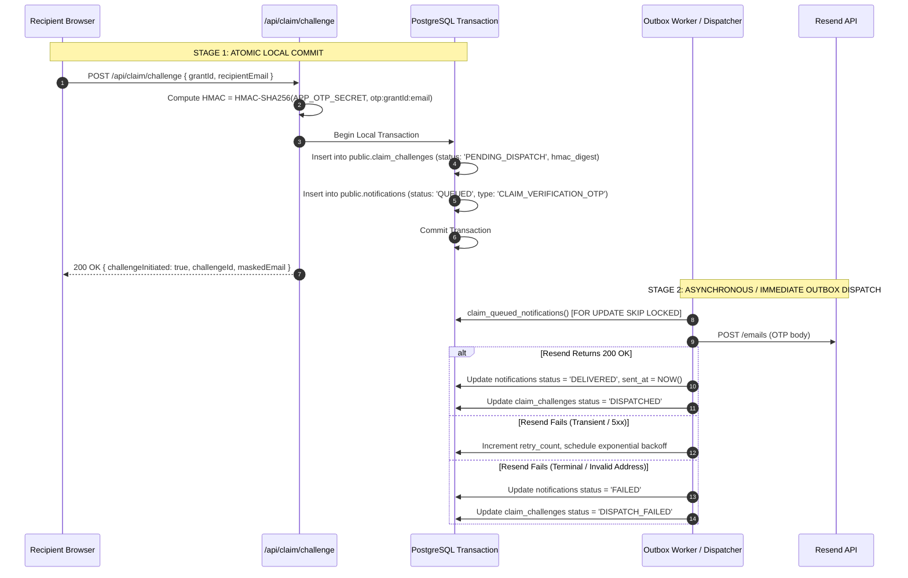

# DESIGN B FINAL ARCHITECTURAL SPECIFICATION & AUDIT (v3.2)
## Transactional Outbox, Browser DEK Wrapping, Idempotent Rotation & BIP-39 Integrity

**Document Version:** 3.2.0  
**Status:** PLANNING ONLY — NO CODE, DATABASE, MIGRATION, OR ENVIRONMENT MUTATIONS  
**Date:** 2026-11-04  
**Project:** DEAD MAN SWITCH (`c:\Users\ASUS\Desktop\DEAD MAN BRO`)  

---

## 1. Executive Summary & Explicit Security Boundary

### 1.1 Scope & Purpose
This document provides the definitive, production-grade architectural specification for **Design B (v3.2)**. It refines v3.1 by eliminating invalid transactional assumptions regarding third-party HTTP services, establishing a strict **Transactional Outbox** pattern for verification emails, specifying the precise browser-to-server boundary during token rotation, enforcing operation idempotency against lost network responses, correcting the BIP-39 checksum definition, and clarifying the lifecycle interaction of locked grants.

### 1.2 Unchanged Threat Model & Security Boundary

```
┌────────────────────────────────────────────────────────────────────────┐
│ WHAT THIS ARCHITECTURE DEFENDS AGAINST                                 │
├────────────────────────────────────────────────────────────────────────┤
│ ✓ Stolen Database / Storage Backups: An attacker possessing complete   │
│   SQL dumps, WAL archives, or Storage snapshots cannot decrypt files.  │
│ ✓ Passive Database Leaks (SQLi / Read Replicas): Read access yields   │
│   only encrypted DEKs and encrypted key envelopes.                     │
│ ✓ Cloud / Storage Bucket Leaks: Storage objects are AES-256-GCM cipher-│
│   text under unique, random 256-bit DEKs.                              │
│ ✓ Rogue Database Administrators: DB superusers cannot decrypt files    │
│   without both the external application key and client-side secrets.   │
│ ✓ Recipient Email Spoofing & Rainbow Tables: Claiming requires proof of│
│   inbox access via server-keyed HMAC-authenticated OTP challenges.     │
│ ✓ Replay Attacks & Lost-Response Retries: Idempotent operations and    │
│   database row-level locks prevent double-rotations or duplicate claims│
└────────────────────────────────────────────────────────────────────────┘

┌────────────────────────────────────────────────────────────────────────┐
│ WHAT THIS ARCHITECTURE DOES NOT PROTECT AGAINST (APPLICATION BOUNDARY) │
├────────────────────────────────────────────────────────────────────────┤
│ ✗ Active Application Server Compromise: If an attacker attains Remote  │
│   Code Execution (RCE) on the Next.js server, they possess             │
│   APP_ENCRYPTION_KEY and APP_OTP_SECRET. They can unwrap recipient     │
│   grants as they are claimed and decrypt files in transit.             │
│ ✗ Compromised Host Environment: Server memory dumps, malicious build   │
│   dependencies (supply chain attacks), or rogue server administrators  │
│   can capture decrypted keys during claim execution.                   │
│ ✗ Client-Side Malware / Rogue Browser Extensions: An attacker with DOM │
│   or JavaScript execution rights in the browser can exfiltrate keys     │
│   from WebCrypto memory while a session is active.                     │
└────────────────────────────────────────────────────────────────────────┘
```

> **Fundamental Principle:** Client-side file encryption paired with server-side envelope encryption provides defense-in-depth against data-layer and storage-layer breaches. It **does not and cannot** provide full zero-knowledge confidentiality against compromise of the active application server executing the API.

---

## 2. Transactional Outbox Pattern for Recipient Email Verification (Correction 1)

### 2.1 The Architectural Defect in v3.1
In v3.1, it was assumed that an external HTTP call to Resend could "participate in a PostgreSQL transaction" and roll back if the API failed. In distributed systems, external HTTP requests cannot join local ACID transactions (Dual-Write / Two-Phase Commit fallacy). If the HTTP call succeeds but the local commit fails, an email with a phantom OTP is delivered. If the local commit succeeds but the network drops before Resend responds, the transaction state is ambiguous.

### 2.2 Transactional Outbox Architecture
To achieve atomic challenge generation and guaranteed email dispatch without dual-write hazards, the system integrates challenge creation directly into the existing `public.notifications` transactional outbox.



### 2.3 Challenge Lifecycle & Redemption Eligibility
A challenge record transitions through strict states:

| Challenge State | Can Recipient Redeem? | Definition |
|---|:---:|---|
| `PENDING_DISPATCH` | **NO** | Challenge committed to DB, notification queued in outbox. Redemption attempts return `425 Too Early ("Verification email dispatch in progress. Please check your inbox.")`. |
| `DISPATCHED` | **YES** | Outbox worker received confirmation from Resend (`status: 'DELIVERED'`). Recipient may submit OTP. |
| `REDEEMED` | **NO** | OTP successfully matched; grant unlocked. Single-use enforcement prevents replay. |
| `EXPIRED` | **NO** | Wall-clock time exceeds `expires_at` (10 minutes from creation). |
| `LOCKED` | **NO** | 3 failed OTP submissions. Challenge permanently invalidated. |
| `DISPATCH_FAILED` | **NO** | Terminal dispatch failure. UI informs claimant: `"Unable to deliver verification email. Please check the recipient address or contact support."` |

### 2.4 Acceptance Criteria & Failure Scenarios (Correction 1)
- **AC-1.1 (Atomic Outbox Insert):** Challenge row and notification outbox row must be inserted inside the exact same PostgreSQL transaction. A crash or rollback must leave neither.
- **AC-1.2 (Redemption Gating):** The redemption RPC must assert `claim_challenges.status = 'DISPATCHED'`. An OTP submitted before dispatch confirmation must be rejected with HTTP 425.
- **Failure Scenario 1.1 (Resend Outage):** If Resend is unreachable (5xx/network timeout), the outbox worker retries with exponential backoff (2s, 8s, 32s). After 3 failed retries, status becomes `DISPATCH_FAILED`. The challenge is never eligible for redemption, preventing un-notified grants from being claimed.
- **Failure Scenario 1.2 (Worker Crash After Resend 200):** If the worker dispatches to Resend but crashes before updating Postgres, the notification re-claim query (`clock_timestamp() - INTERVAL '10 minutes'`) picks it up. Idempotency key `otp:<challenge_id>` prevents duplicate emails via Resend's idempotency header.

---

## 3. Browser-Side DEK Wrapping & Token Rotation Security Boundary (Correction 2)

### 3.1 Security Boundary Definition
During token rotation, the owner browser must re-encrypt file access keys for the new recipient delivery token. **The server must never participate in file key unwrapping or plaintext DEK handling.**

```
BROWSER RUNTIME (Client-Side Memory Sandbox)
┌────────────────────────────────────────────────────────────────────────┐
│ 1. Owner enters Master Passphrase -> derives passphrase_kek            │
│ 2. Unwraps vault_key_envelope_primary -> Master Vault Key (MVK)        │
│ 3. Generates 32-byte CSPRNG rawToken                                   │
│ 4. Derives newRecipientKek = deriveKEK(rawToken, 'recipient-claim-salt')│
│ 5. For each file in switch:                                            │
│    a. Unwraps encrypted_dek_owner using MVK -> plaintext DEK           │
│    b. Re-wraps plaintext DEK using newRecipientKek -> newEncRecipientDEK│
│    c. Overwrites plaintext DEK buffer with 0                           │
│ 6. Wraps rawToken using MVK -> newEncryptedTokenOwner                  │
└────────────────────────────────────────────────────────────────────────┘
                                    │
                                    │ HTTPS POST /api/switches/provision-token
                                    ▼
SERVER RUNTIME (Next.js Node.js API Route)
┌────────────────────────────────────────────────────────────────────────┐
│ Receives strictly MINIMAL payload:                                     │
│ - switchId, recipientId, operationId                                   │
│ - rawToken (needed exclusively for server envelope encryption)        │
│ - newEncryptedTokenOwner (opaque ciphertext for owner vault)           │
│ - fileDeks: [{ fileId, encryptedDekRecipient }] (opaque ciphertexts)   │
│                                                                        │
│ WHAT THE SERVER NEVER RECEIVES:                                        │
│ ✗ Owner Master Passphrase or MVK                                       │
│ ✗ Plaintext file DEKs                                                  │
│ ✗ Plaintext file payload contents or plaintext storage blobs           │
└────────────────────────────────────────────────────────────────────────┘
```

### 3.2 Exact Field Specification Sent to Server

| Field Name | Type | Sensitive? | Justification for Server Receipt |
|---|---|:---:|---|
| `switchId` | UUID v4 | No | Identifies the switch; validates caller ownership in database. |
| `recipientId` | UUID v4 | No | Identifies the target recipient; validates switch association. |
| `operationId` | UUID v4 | No | Idempotency key ensuring exactly-once execution. |
| `rawToken` | 64-char hex | **Yes** | **Required strictly for server envelope encryption:** The server must encrypt `rawToken` using `APP_ENCRYPTION_KEY` into `encrypted_key_material` before saving to DB. |
| `newEncryptedTokenOwner` | Base64 string | No | Opaque ciphertext (wrapped by owner MVK). Stored in DB for future owner uploads. Server cannot decrypt. |
| `fileDeks` | Array of `{ fileId, encryptedDekRecipient }` | No | Opaque ciphertexts (wrapped by recipient KEK). Replaces existing database columns. Server cannot decrypt. |

### 3.3 Acceptance Criteria & Failure Scenarios (Correction 2)
- **AC-2.1 (Zero Server Plaintext DEKs):** Server API routes must neither accept, parse, nor log plaintext DEKs. All `encryptedDekRecipient` fields received must be validated as base64-encoded AES-GCM ciphertexts.
- **AC-2.2 (Browser Memory Scrubbing):** In the browser client, raw DEK buffers must be wiped (`new Uint8Array(rawDekBuffer).fill(0)`) immediately after wrapping with `newRecipientKek`.
- **Failure Scenario 2.1 (Browser Memory Sniffing):** If client-side malware has access to browser memory, it can inspect un-wrapped DEKs during rotation. *Mitigation:* Documented in threat model; client-side execution environment must be trusted.
- **Failure Scenario 2.2 (Mismatched File Count):** If the client submits `fileDeks` array with 4 items for a switch that possesses 5 files, the database RPC must reject the entire operation with code `22000 ("File count mismatch during token rotation")`. No partial key re-wrapping is permitted.

---

## 4. Idempotent Token Rotation & Locked Grant Semantics (Correction 3)

### 4.1 The Network Partition / Lost Response Problem
If the client issues a rotation request, the server executes the rotation and commits the database transaction, but an intermittent network drop, proxy timeout, or client crash drops the HTTP 200 response:
- If the client retries without idempotency, the server attempts to rotate an already-rotated grant, double-revoking tokens or rejecting the request as invalid.
- If the client assumes failure, client and server states diverge.

### 4.2 Idempotent Rotation Architecture
Rotation uses a client-generated UUID v4 `operationId` (idempotency key) stored in `public.token_rotation_operations`:

```sql
CREATE TABLE public.token_rotation_operations (
    operation_id uuid PRIMARY KEY,
    switch_id uuid NOT NULL REFERENCES public.switches(id) ON DELETE CASCADE,
    recipient_id uuid NOT NULL REFERENCES public.switch_recipients(id) ON DELETE CASCADE,
    token_id uuid REFERENCES public.recipient_claim_tokens(id) ON DELETE SET NULL,
    status text NOT NULL CHECK (status IN ('COMMITTED', 'FAILED')),
    response_payload jsonb NOT NULL,
    created_at timestamptz NOT NULL DEFAULT clock_timestamp()
);
```

#### Idempotency Protocol Execution Flow
1. Client generates `operationId = crypto.randomUUID()`.
2. Client sends request to `POST /api/switches/provision-token` with `operationId`.
3. Server opens database transaction and checks `token_rotation_operations` for `operationId`:
   - **If Found with status 'COMMITTED':** Immediately return the stored `response_payload` with HTTP 200. **Do not re-execute rotation.**
   - **If Found with status 'FAILED':** Return stored error with original status code.
   - **If Not Found:** Proceed with atomic rotation RPC.
4. The atomic RPC executes:
   - Validates ownership, re-wraps file DEKs, revokes old active tokens, inserts new token row.
   - Inserts record into `token_rotation_operations` with `status: 'COMMITTED'` and `response_payload: { success: true, tokenId, expiresAt }`.
5. Transaction commits atomically. Response returned to client.

### 4.3 Interaction of Locked Grants with Partial Unique Index & Replacement
In v3.1, a grant could enter the `LOCKED` state (e.g., after 3 failed OTP attempts, setting `locked_at = NOW()`).

#### The Problem
The partial unique index is defined as:
```sql
CREATE UNIQUE INDEX idx_single_active_grant_per_recipient
ON public.recipient_claim_tokens (switch_id, recipient_id)
WHERE revoked_at IS NULL AND redeemed_at IS NULL AND locked_at IS NULL;
```
If a grant is `LOCKED`, `locked_at` is NOT null. Therefore, the locked row falls **outside** the partial index predicate. 

#### Clarification of Semantics & Replacement Rule
- **While Locked:** The recipient cannot claim the locked grant.
- **Can the Owner Replace a Locked Grant?** **YES.** If the recipient is locked out, the switch owner must be able to rotate or replace the grant to restore emergency access.
- **Atomic Transition Rule in RPC:** When `execute_staged_token_rotation()` runs:
  ```sql
  -- Transition ALL non-terminal rows (both active AND locked) to REVOKED
  UPDATE public.recipient_claim_tokens
  SET revoked_at = v_now
  WHERE switch_id = p_switch_id
    AND recipient_id = p_recipient_id
    AND revoked_at IS NULL
    AND redeemed_at IS NULL;
  -- Both active (locked_at IS NULL) and locked (locked_at IS NOT NULL) 
  -- rows are now explicitly REVOKED.
  
  -- Insert the fresh grant
  INSERT INTO public.recipient_claim_tokens (
      switch_id, recipient_id, token_hash, encrypted_key_material, 
      encrypted_token_owner, expires_at, locked_at, revoked_at
  ) VALUES (
      p_switch_id, p_recipient_id, v_token_hash, p_encrypted_key_material,
      p_encrypted_token_owner, p_expires_at, NULL, NULL
  );
  ```
- **Invariants Maintained:**
  1. Only exactly **one** unrevoked grant can exist for a recipient.
  2. Rotating a locked grant cleanly sets `revoked_at = NOW()`, clearing the lockout and issuing a pristine active grant.

### 4.4 Acceptance Criteria & Failure Scenarios (Correction 3)
- **AC-3.1 (Idempotent Retry Guarantee):** Calling rotation with the same `operationId` 5 consecutive times must produce identical HTTP 200 responses and create exactly **one** new token row in the database.
- **AC-3.2 (Locked Grant Replacement):** An owner rotating a switch whose token has `locked_at IS NOT NULL` must successfully revoke the locked token and create a new `ACTIVE` token without index collision.
- **Failure Scenario 3.1 (Lost Network Response):** Database commits rotation, but client disconnects before receiving response. Client reconnects, resends payload with same `operationId`. Server returns cached `tokenId`. No duplicate tokens created, no double-re-wrapping of file DEKs.

---

## 5. Precise BIP-39 Checksum Specification (Correction 4)

### 5.1 Exact Cryptographic Definition
In accordance with the official BIP-39 standard for 256 bits of initial entropy:

$$\text{Initial Entropy (ENT)} = 256\text{ bits (32 bytes from CSPRNG)}$$
$$\text{Checksum Length (CS)} = \frac{\text{ENT}}{32} = \frac{256}{32} = 8\text{ bits}$$
$$\text{Total Bits (MS)} = \text{ENT} + \text{CS} = 256 + 8 = 264\text{ bits}$$
$$\text{Word Count} = \frac{264\text{ bits}}{11\text{ bits per word}} = 24\text{ words}$$

### 5.2 Bitwise Derivation of Checksum
The checksum is the **first 8 bits (the most significant byte, index 0)** of the SHA-256 digest of the entropy:

```typescript
// 1. Generate 32 bytes (256 bits) of CSPRNG entropy
const entropy = crypto.getRandomValues(new Uint8Array(32));

// 2. Compute SHA-256 hash of the 32-byte entropy buffer
const hashBuffer = await crypto.subtle.digest('SHA-256', entropy);
const hashArray = new Uint8Array(hashBuffer);

// 3. Extract the first 8 bits (first byte of hash)
const checksumByte = hashArray[0]; // Exactly 8 bits (bits 0 to 7)

// 4. Concatenate 256 bits of entropy + 8 bits of checksum = 264 bits
// 5. Divide into 24 chunks of 11 bits each
// 6. Map each 11-bit integer [0..2047] to BIP-39 English wordlist
```

### 5.3 Acceptance Criteria & Failure Scenarios (Correction 4)
- **AC-4.1 (Exact Checksum Verification):** Client recovery code validator must extract the first byte of `SHA-256(entropy)` and verify all 8 bits against the checksum embedded in word 24.
- **AC-4.2 (256-bit Entropy Assertion):** Mnemonic generation must assert `entropy.byteLength === 32`.
- **Failure Scenario 4.1 (Corrupted Word in Recovery Sheet):** If the user mistypes word 24 or any other word, the 8-bit checksum check fails with probability $1 - 2^{-8} = 99.61\%$. The UI rejects the code immediately before attempting expensive PBKDF2 derivation: `"Invalid recovery code checksum. Please verify word spellings."`

---

## 6. Comprehensive Acceptance Criteria Matrix

| Area | Requirement / Correction | Acceptance Criteria |
|:---:|---|---|
| **Outbox** | AC-1.1: Atomic Challenge Creation | `claim_challenges` row and `notifications` row inserted in single SQL transaction. |
| **Outbox** | AC-1.2: Redemption Gating | `/api/claim/redeem` rejects challenge unless `claim_challenges.status = 'DISPATCHED'`. |
| **Security** | AC-2.1: Server Plaintext DEK Scrubbing | Next.js API rejects any rotation payload containing unencrypted DEKs. Plaintext DEKs never sent over network. |
| **Security** | AC-2.2: Browser DEK Hygiene | Browser memory explicitly zeroes out raw DEK buffers immediately after re-wrapping. |
| **Idempotency** | AC-3.1: Exactly-Once Rotation | Identical `operationId` submissions return cached response without duplicate mutations. |
| **Lifecycle** | AC-3.2: Locked Grant Revocation | Rotation of a locked token cleanly revokes it and issues an active replacement without index error. |
| **Crypto** | AC-4.1: BIP-39 Checksum Validation | Word 24 verified against first byte (`hash[0]`, 8 bits) of `SHA-256(entropy)`. 99.6% error catch rate. |

---

## 7. Unresolved Residual Risks (Transparent Risk Acceptance)

The following risks are inherent to the selected architecture and are explicitly acknowledged:

1. **Application Server Key Custody:**
   - Because `APP_ENCRYPTION_KEY` and `APP_OTP_SECRET` reside on the Next.js production host, root compromise of the Next.js runtime environment allows an attacker to intercept recipient keys during active claim redemptions.
2. **Third-Party Email Relay Vulnerability (Resend):**
   - The security of recipient inbox verification relies on DNS MX records, SMTP TLS transit, and Resend API integrity. Compromise of the recipient's mail provider allows OTP interception.
3. **Owner Passphrase & Recovery Sheet Loss:**
   - If the switch owner loses both their master passphrase and their 24-word recovery sheet, their personal access to files is unrecoverable. (Recipient delivery remains intact via `encrypted_key_material`).
4. **Cloud Database WAL Retention:**
   - Historical WAL archives in Supabase managed infrastructure retain deleted rows until the Point-in-Time Recovery (PITR) window (7 to 30 days) expires. Physical erasure of legacy plaintext rows occurs only after WAL recycling.

---

## 8. Summary of Version 3.2 Corrections

1. **Transactional Outbox for Resend:** Replaced the invalid assumption that external HTTP calls join PostgreSQL transactions with an atomic outbox pattern (`notifications` table + async dispatcher). Added `PENDING_DISPATCH` gating so OTPs cannot be redeemed before delivery confirmation.
2. **Clarified Token Rotation Security Boundary:** Explicitly proved that file DEK unwrapping and re-wrapping happen client-side in the browser using the owner MVK. Detailed the exact minimal payload sent to the server, confirming the server never sees plaintext DEKs or the MVK.
3. **Idempotent Token Rotation:** Added `operation_id` tracking table ensuring network partition retries return cached responses without duplicate database mutations. Defined atomic RPC transition of locked grants to `REVOKED` during replacement, harmonizing with the partial unique index.
4. **Corrected BIP-39 Checksum Specification:** Defined the exact mathematical checksum ($256\text{ bits} / 32 = 8\text{ bits}$) as the first byte (`hash[0]`) of `SHA-256(entropy)`, concatenated to 264 bits and divided into 24 11-bit word indices.

---

> **Plan Status:** Version 3.2.0 Complete. Saved to `DESIGN_B_FINAL_REVIEW_v3.2.md`.  
> **Explicit Confirmation:** This document is strictly an architectural specification and plan. **NO** source code, database tables, SQL records, migrations, environment variables, or deployment settings were modified in any way. Awaiting explicit user approval before proceeding to implementation.
