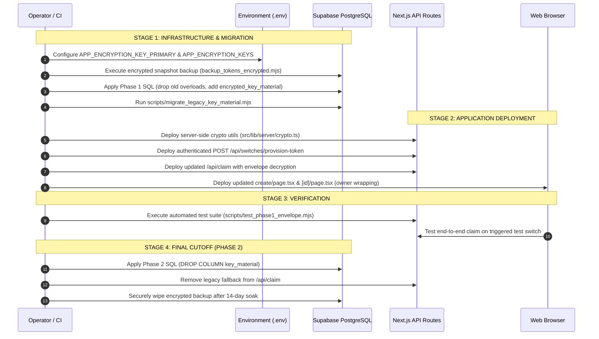

# DESIGN B REVISED IMPLEMENTATION PLAN
## Server-Side Envelope Encryption of `key_material` at Rest

**Document Version:** 2.0.0  
**Status:** PLANNING ONLY — NO CODE OR DATABASE MODIFICATIONS PERMITTED  
**Date:** 2026-11-04  
**Project:** DEAD MAN SWITCH (`c:\Users\ASUS\Desktop\DEAD MAN BRO`)  

---

## 1. Executive Summary & Core Security Architecture

### 1.1 Objective
Eliminate the plaintext storage and exposure of recipient key material (`key_material`) across database tables, RPCs, and query results, while strictly preserving:
1. **Client-side zero-knowledge file encryption/decryption:** Plaintext file payloads **never** touch the server. Ciphertext files in Supabase Storage remain AES-256-GCM encrypted. The recipient browser performs file decryption in its local WebCrypto sandbox.
2. **Zero downtime & zero data loss:** Existing switches and files remain fully claimable and decryptable throughout the migration.
3. **Defense-in-depth against database exfiltration:** If the PostgreSQL database, WAL logs, or backups are leaked or stolen, an attacker acquires only ciphertext envelopes. Without the external `APP_ENCRYPTION_KEY`, no recipient files can be decrypted.

### 1.2 The Two-Phase Transition Model

```
┌────────────────────────────────────────────────────────────────────────┐
│ PHASE 1: TRANSITIONAL MIGRATION (DUAL-READ, SECURE-WRITE)             │
│ - New column: encrypted_key_material text                              │
│ - New switch creation & token rotation write ONLY encrypted envelope   │
│ - Claim API reads encrypted_key_material; falls back to key_material   │
│ - Offline encrypted data migration converts legacy rows                │
└───────────────────────────────────┬────────────────────────────────────┘
                                    │ Verification & Soak Period
┌───────────────────────────────────▼────────────────────────────────────┐
│ PHASE 2: FINAL TARGET ARCHITECTURE (ZERO PLAINTEXT KEY MATERIAL)       │
│ - Drop public.recipient_claim_tokens.key_material column entirely      │
│ - Drop legacy RPC overloads accepting/returning plaintext keys         │
│ - Remove legacy fallback from /api/claim                               │
│ - Neither database, API, nor network logs ever see plaintext tokens    │
└────────────────────────────────────────────────────────────────────────┘
```

---

## 2. Cryptographic Envelope Specification & Key Management

### 2.1 Envelope Format
`encrypted_key_material` is serialized as a strict JSON envelope string:

```json
{
  "v": 1,
  "kid": "dm-k1-2026",
  "alg": "A256GCM",
  "iv": "u1w3k...",
  "tag": "e7b0a...",
  "ct": "8f21c..."
}
```

| Field | Type | Description |
|---|---|---|
| `v` | integer | Envelope version format (`1`). |
| `kid` | string | Key Identifier matching an active key in `APP_ENCRYPTION_KEYS`. |
| `alg` | string | Algorithm identifier (`A256GCM` = AES-256-GCM with 96-bit IV and 128-bit auth tag). |
| `iv` | string | Base64-encoded 12-byte random IV (`crypto.randomBytes(12)`). |
| `tag` | string | Base64-encoded 16-byte authentication tag from GCM cipher. |
| `ct` | string | Base64-encoded ciphertext of the 64-hex-character `rawToken`. |

### 2.2 Environment Variables & Key Ring Configuration

```env
# Primary key used for all NEW encryptions (format: <kid>:<64-hex-chars>)
APP_ENCRYPTION_KEY_PRIMARY="dm-k1-2026:0123456789abcdef0123456789abcdef0123456789abcdef0123456789abcdef"

# Full key ring for decryption supporting seamless rotation (comma-separated <kid>:<key>)
APP_ENCRYPTION_KEYS="dm-k1-2026:0123456789abcdef0123456789abcdef0123456789abcdef0123456789abcdef"
```

### 2.3 Secret Handling & Git Safety Rules
- **No Client Prefix:** Suffix or prefix `NEXT_PUBLIC_` is strictly prohibited. Next.js compiler will automatically exclude these variables from browser bundles.
- **Verification Check:** Add an automated assertion during `npm run build` ensuring `APP_ENCRYPTION_KEY` does not appear in any `.next/static` artifact.
- **Git Ignored:** `.env.local` is already in `.gitignore`. Add `APP_ENCRYPTION_KEY_PRIMARY` dummy entry to `.env.example`.

### 2.4 Key Lifecycle: Rotation, Compromise & Disaster Recovery

#### Rotation Procedure (No Downtime)
1. Generate new 256-bit key: `openssl rand -hex 32` with new ID `dm-k2-2027`.
2. Add to production environment:
   ```env
   APP_ENCRYPTION_KEY_PRIMARY="dm-k2-2027:<new_key>"
   APP_ENCRYPTION_KEYS="dm-k1-2026:<old_key>,dm-k2-2027:<new_key>"
   ```
3. Run background re-encryption worker `scripts/reencrypt_keys.mjs`:
   - Scans rows where `encrypted_key_material` does not have `"kid": "dm-k2-2027"`.
   - Decrypts with `dm-k1-2026`, re-encrypts with `dm-k2-2027`, updates row.
4. Once all rows are re-keyed, decommission `dm-k1-2026` by removing it from `APP_ENCRYPTION_KEYS`.

#### Catastrophic Key Loss Recovery
If `APP_ENCRYPTION_KEY` is completely lost (e.g., destroyed vault, unrecoverable environment):
- **Recovery Path:** Because each token also has `encrypted_token_owner` (wrapped client-side with the owner's PBKDF2 vault key), the **owner can recover and re-key the switch** upon logging in. The application dashboard prompts the owner to "Re-authenticate and restore delivery grant," which unwraps `encrypted_token_owner` using `ownerKek` in the browser and re-submits a new server-encrypted envelope under a new `APP_ENCRYPTION_KEY`.

---

## 3. Database Migration & Overload Safety

### 3.1 Handling PostgreSQL Function Overloads Safely

#### The Risk
In PostgreSQL, `CREATE OR REPLACE FUNCTION` with a different parameter list does **not** replace the existing function—it creates a **new overload**. Supabase PostgREST rejects RPC calls with `PGRST204 (ambiguous function call)` if overloads have compatible or overlapping defaults.

Currently, the live database contains two overloads of `rotate_claim_token`:
1. `rotate_claim_token(uuid, uuid, text, timestamptz)`
2. `rotate_claim_token(uuid, uuid, text, timestamptz, text, text)`

#### Safe Dropping Sequence
The migration script must explicitly drop all existing overloads before creating the canonical function:

```sql
-- Drop old batch3 overload
DROP FUNCTION IF EXISTS public.rotate_claim_token(uuid, uuid, text, timestamp with time zone);

-- Drop batch4 overload that accepted plaintext p_key_material
DROP FUNCTION IF EXISTS public.rotate_claim_token(uuid, uuid, text, timestamp with time zone, text, text);
```

### 3.2 Phase 1 Database Migration Script
**Path:** `supabase/migrations/20261105_phase1_key_material_at_rest.sql`

```sql
-- 1. Add envelope column
ALTER TABLE public.recipient_claim_tokens
ADD COLUMN IF NOT EXISTS encrypted_key_material text;

-- 2. Cleanly replace rotate_claim_token with secure signature (NO plaintext key_material parameter)
DROP FUNCTION IF EXISTS public.rotate_claim_token(uuid, uuid, text, timestamp with time zone);
DROP FUNCTION IF EXISTS public.rotate_claim_token(uuid, uuid, text, timestamp with time zone, text, text);

CREATE OR REPLACE FUNCTION public.rotate_claim_token(
    p_switch_id uuid,
    p_recipient_id uuid,
    p_new_token_hash text,
    p_expires_at timestamp with time zone,
    p_encrypted_key_material text,
    p_encrypted_token_owner text DEFAULT NULL
)
RETURNS jsonb
LANGUAGE plpgsql
SECURITY DEFINER
SET search_path = public, pg_temp
AS $$
DECLARE
    v_user_id uuid := auth.uid();
    v_switch public.switches%ROWTYPE;
    v_recipient public.switch_recipients%ROWTYPE;
    v_new_token_id uuid;
    v_user_email text;
    v_now timestamptz := clock_timestamp();
BEGIN
    IF v_user_id IS NULL THEN
        RAISE EXCEPTION 'Not authenticated' USING ERRCODE = '42501';
    END IF;

    -- Strict authorization & ownership validation
    SELECT * INTO v_switch FROM public.switches WHERE id = p_switch_id FOR UPDATE;
    IF NOT FOUND THEN RAISE EXCEPTION 'Switch not found' USING ERRCODE = 'P0002'; END IF;
    IF v_switch.user_id <> v_user_id THEN
        RAISE EXCEPTION 'Unauthorized: switch does not belong to caller' USING ERRCODE = '42501';
    END IF;
    IF v_switch.status IN ('TRIGGERED', 'CANCELLED') THEN
        RAISE EXCEPTION 'Cannot rotate token on switch with status %', v_switch.status USING ERRCODE = '22000';
    END IF;

    SELECT * INTO v_recipient FROM public.switch_recipients
    WHERE id = p_recipient_id AND switch_id = p_switch_id;
    IF NOT FOUND THEN RAISE EXCEPTION 'Recipient not found' USING ERRCODE = 'P0002'; END IF;

    -- Ensure encrypted payload is provided
    IF p_encrypted_key_material IS NULL OR length(trim(p_encrypted_key_material)) = 0 THEN
        RAISE EXCEPTION 'Missing encrypted key material envelope' USING ERRCODE = '22000';
    END IF;

    -- Revoke existing active tokens
    UPDATE public.recipient_claim_tokens
    SET revoked_at = v_now
    WHERE switch_id = p_switch_id
      AND recipient_id = p_recipient_id
      AND revoked_at IS NULL
      AND redeemed_at IS NULL;

    -- Insert new token record (key_material remains NULL)
    INSERT INTO public.recipient_claim_tokens (
        switch_id,
        recipient_id,
        token_hash,
        expires_at,
        key_material,
        encrypted_token_owner,
        encrypted_key_material
    )
    VALUES (
        p_switch_id,
        p_recipient_id,
        p_new_token_hash,
        p_expires_at,
        NULL, -- NEVER store plaintext key_material
        p_encrypted_token_owner,
        p_encrypted_key_material
    )
    RETURNING id INTO v_new_token_id;

    SELECT email INTO v_user_email FROM auth.users WHERE id = v_user_id;

    INSERT INTO public.audit_logs (user_id, switch_id, action, metadata, created_at)
    VALUES (
        v_user_id, p_switch_id, 'CLAIM_TOKEN_ROTATED',
        jsonb_build_object('actor', v_user_email, 'recipient_email', v_recipient.recipient_email, 'token_id', v_new_token_id),
        v_now
    );

    RETURN jsonb_build_object('success', true, 'token_id', v_new_token_id);
END;
$$;

-- 3. Update redeem_recipient_claim to return BOTH fields during Phase 1
CREATE OR REPLACE FUNCTION public.redeem_recipient_claim(
    p_recipient_email text,
    p_grant_id uuid DEFAULT NULL::uuid,
    p_token_hash text DEFAULT NULL::text
)
RETURNS jsonb
LANGUAGE plpgsql
SECURITY DEFINER
SET search_path = public, pg_temp
AS $$
DECLARE
    v_token public.recipient_claim_tokens%ROWTYPE;
    v_switch public.switches%ROWTYPE;
    v_recipient public.switch_recipients%ROWTYPE;
    v_files jsonb;
    v_now timestamptz := clock_timestamp();
BEGIN
    IF p_grant_id IS NOT NULL THEN
        SELECT * INTO v_token FROM public.recipient_claim_tokens WHERE id = p_grant_id FOR UPDATE;
    ELSIF p_token_hash IS NOT NULL THEN
        SELECT * INTO v_token FROM public.recipient_claim_tokens WHERE token_hash = p_token_hash FOR UPDATE;
    ELSE
        RETURN jsonb_build_object('success', false, 'error', 'Missing access grant or claim token.');
    END IF;

    IF NOT FOUND THEN
        RETURN jsonb_build_object('success', false, 'error', 'Invalid or unissued access link.');
    END IF;

    IF v_token.revoked_at IS NOT NULL THEN
        INSERT INTO public.audit_logs (switch_id, action, metadata, created_at)
        VALUES (v_token.switch_id, 'CLAIM_REJECTED',
          jsonb_build_object('actor', p_recipient_email, 'reason', 'token_revoked'), v_now);
        RETURN jsonb_build_object('success', false, 'error', 'This access link has been revoked.');
    END IF;

    IF v_token.expires_at < v_now THEN
        INSERT INTO public.audit_logs (switch_id, action, metadata, created_at)
        VALUES (v_token.switch_id, 'CLAIM_REJECTED',
          jsonb_build_object('actor', p_recipient_email, 'reason', 'token_expired'), v_now);
        RETURN jsonb_build_object('success', false, 'error', 'This access link has expired.');
    END IF;

    IF v_token.redeemed_at IS NOT NULL AND v_token.redemption_count >= v_token.max_redemptions THEN
        INSERT INTO public.audit_logs (switch_id, action, metadata, created_at)
        VALUES (v_token.switch_id, 'CLAIM_REJECTED',
          jsonb_build_object('actor', p_recipient_email, 'reason', 'redemption_limit_reached'), v_now);
        RETURN jsonb_build_object('success', false, 'error', 'Maximum access limit reached for this emergency link.');
    END IF;

    SELECT * INTO v_switch FROM public.switches WHERE id = v_token.switch_id;
    IF v_switch.status <> 'TRIGGERED' THEN
        INSERT INTO public.audit_logs (switch_id, action, metadata, created_at)
        VALUES (v_token.switch_id, 'CLAIM_REJECTED',
          jsonb_build_object('actor', p_recipient_email, 'reason', 'switch_not_triggered', 'status', v_switch.status), v_now);
        RETURN jsonb_build_object('success', false, 'error', 'Switch is not in TRIGGERED state. Files remain locked.');
    END IF;

    SELECT * INTO v_recipient FROM public.switch_recipients WHERE id = v_token.recipient_id;
    IF LOWER(TRIM(v_recipient.recipient_email)) <> LOWER(TRIM(p_recipient_email)) THEN
        INSERT INTO public.audit_logs (switch_id, action, metadata, created_at)
        VALUES (v_token.switch_id, 'CLAIM_REJECTED',
          jsonb_build_object('actor', p_recipient_email, 'reason', 'email_mismatch'), v_now);
        RETURN jsonb_build_object('success', false, 'error', 'Recipient identity verification failed. Email does not match authorization.');
    END IF;

    -- Strict validation: Token MUST have usable key material
    IF v_token.encrypted_key_material IS NULL AND v_token.key_material IS NULL THEN
        INSERT INTO public.audit_logs (switch_id, action, metadata, created_at)
        VALUES (v_token.switch_id, 'CLAIM_FAILED_MISSING_KEY',
          jsonb_build_object('actor', p_recipient_email, 'token_id', v_token.id), v_now);
        RETURN jsonb_build_object('success', false, 'error', 'Access grant is improperly configured (cryptographic keys missing). Please contact the switch administrator.');
    END IF;

    UPDATE public.recipient_claim_tokens
    SET redeemed_at = COALESCE(redeemed_at, v_now), redemption_count = redemption_count + 1
    WHERE id = v_token.id;

    SELECT jsonb_agg(jsonb_build_object(
        'id', f.id, 'original_filename', f.original_filename,
        'file_size', f.file_size, 'encrypted', f.encrypted,
        'file_hash', f.file_hash, 'iv', f.iv,
        'storage_path', f.storage_path,
        'encrypted_dek_recipient', f.encrypted_dek_recipient,
        'encryption_version', f.encryption_version,
        'mime_type', f.mime_type
    )) INTO v_files FROM public.files f WHERE f.switch_id = v_switch.id;

    INSERT INTO public.audit_logs (switch_id, action, metadata, created_at)
    VALUES (
        v_switch.id, 'CLAIM_REDEEMED',
        jsonb_build_object(
            'actor', p_recipient_email,
            'recipient_name', v_recipient.recipient_name,
            'files_released', jsonb_array_length(COALESCE(v_files, '[]'::jsonb)),
            'grant_id', v_token.id
        ),
        v_now
    );

    RETURN jsonb_build_object(
        'success', true,
        'switch_title', v_switch.title,
        'switch_description', v_switch.description,
        'recipient_name', v_recipient.recipient_name,
        'recipient_email', v_recipient.recipient_email,
        'triggered_at', v_switch.triggered_at,
        'key_material', v_token.key_material,                   -- Phase 1 legacy fallback
        'encrypted_key_material', v_token.encrypted_key_material, -- Phase 1 & 2 primary
        'files', COALESCE(v_files, '[]'::jsonb)
    );
END;
$$;
```

---

## 4. Remedying Missing Key Material & Trigger Token Generation

### 4.1 Critical Finding from Live Database Audit
Inspecting live `public.recipient_claim_tokens` confirmed:
- Row 1: `key_material`: NULL, `encrypted_token_owner`: NULL (Legacy Batch 2)
- Row 2: `key_material`: NULL, `encrypted_token_owner`: NULL (Legacy Batch 2)
- Row 3: `key_material`: Present (plaintext), `encrypted_token_owner`: NULL (Batch 4)

Furthermore, in [`process_switch_expirations()`](file:///c:/Users/ASUS/Desktop/DEAD%20MAN%20BRO/supabase/migrations/20261022_batch4_recipient_delivery.sql#L79-L84):
If a switch expires without an unrevoked token row, pg_cron executes:
```sql
INSERT INTO public.recipient_claim_tokens (switch_id, recipient_id, token_hash, expires_at)
VALUES (v_switch.id, v_rec.id, encode(sha256(gen_random_bytes(32)), 'hex'), v_now + INTERVAL '30 days')
```
**This inserts a row where key material is completely missing.** The recipient receives an email, claims the link, and is then blocked because no decryption key exists to unwrap the files.

### 4.2 Fix in `process_switch_expirations()`
Update the trigger logic to prevent issuing hollow tokens:

```sql
-- In process_switch_expirations():
SELECT id INTO v_token_id
FROM public.recipient_claim_tokens
WHERE switch_id = v_switch.id 
  AND recipient_id = v_rec.id 
  AND revoked_at IS NULL
  AND (encrypted_key_material IS NOT NULL OR key_material IS NOT NULL)
ORDER BY created_at DESC LIMIT 1;

IF v_token_id IS NULL THEN
  -- DO NOT generate an empty token! Log the critical configuration failure
  INSERT INTO public.audit_logs (user_id, switch_id, action, metadata, created_at)
  VALUES (
    v_switch.user_id, v_switch.id, 'TRIGGER_DELIVERY_HALTED_NO_KEY',
    jsonb_build_object('recipient_id', v_rec.id, 'recipient_email', v_rec.recipient_email, 'reason', 'no_active_key_material'),
    v_now
  );
  -- Skip notification dispatch for this un-keyed recipient to avoid sending broken links
  CONTINUE;
END IF;
```

---

## 5. Tracing & Verifying `encrypted_token_owner`

### 5.1 Verification of Existing Implementation
Our codebase audit revealed:
- `encrypted_token_owner` exists as a column in `public.recipient_claim_tokens`.
- It is **never written** in [`src/app/dashboard/create/page.tsx`](file:///c:/Users/ASUS/Desktop/DEAD%20MAN%20BRO/src/app/dashboard/create/page.tsx).
- It is **never queried or unwrapped** in [`src/app/dashboard/[id]/page.tsx`](file:///c:/Users/ASUS/Desktop/DEAD%20MAN%20BRO/src/app/dashboard/%5Bid%5D/page.tsx).
- **Conclusion:** Any assumption that `encrypted_token_owner` is already working is incorrect. It must be explicitly implemented in this plan.

### 5.2 The Complete Owner Wrap/Unwrap Specification

#### Step 1: Owner Wrap at Creation / Rotation (Client-Side)
When generating a new delivery grant in the browser:
```typescript
// 1. Generate 256-bit random token
const { rawToken, tokenHashPromise } = generateRecipientClaimToken();
const tokenHash = await tokenHashPromise;

// 2. Derive owner's personal KEK
const ownerKek = await deriveKEK(user.id, 'owner-vault-salt');

// 3. Wrap rawToken for the owner (using AES-GCM envelope)
const enc = new TextEncoder();
const rawTokenBytes = enc.encode(rawToken);
const ownerIv = crypto.getRandomValues(new Uint8Array(12));
const wrappedTokenBuffer = await crypto.subtle.encrypt(
  { name: 'AES-GCM', iv: ownerIv },
  ownerKek,
  rawTokenBytes
);
const encryptedTokenOwner = btoa(JSON.stringify({
  iv: bufferToBase64(ownerIv),
  ct: bufferToBase64(wrappedTokenBuffer)
}));
```

#### Step 2: Storage
`encryptedTokenOwner` is sent to the server alongside the new switch or token rotation, and saved directly into `public.recipient_claim_tokens.encrypted_token_owner`.

#### Step 3: Owner Unwrap on Dashboard (`[id]/page.tsx`)
When the owner opens their switch dashboard to upload a new file:
1. The page selects `encrypted_token_owner` via Supabase client:
   ```typescript
   const { data } = await supabase
     .from('recipient_claim_tokens')
     .select('id, encrypted_token_owner, expires_at')
     .eq('switch_id', switchId)
     .is('revoked_at', null)
     .maybeSingle();
   ```
2. The browser unwraps `rawToken` locally on demand:
   ```typescript
   async function getCachedOrUnwrappedRawToken(): Promise<string> {
     const ownerKek = await deriveKEK(user.id, 'owner-vault-salt');
     const envelope = JSON.parse(atob(data.encrypted_token_owner));
     const iv = base64ToBuffer(envelope.iv);
     const ct = base64ToBuffer(envelope.ct);
     const decryptedBytes = await crypto.subtle.decrypt(
       { name: 'AES-GCM', iv },
       ownerKek,
       ct
     );
     return new TextDecoder().decode(decryptedBytes);
   }
   ```
3. During file upload:
   - File DEK is generated.
   - File is encrypted (`encryptFile(file, dek)`).
   - Recipient KEK is derived: `recipientKek = await deriveKEK(unwrappedRawToken, 'recipient-claim-salt')`.
   - DEK is wrapped for recipient: `wrapDEK(dek, recipientKek)`.
   - File is uploaded to storage.
   - `unwrappedRawToken` is wiped from memory as soon as upload completes.
4. **Security outcome:** The database **never** contains plaintext `key_material`, yet the owner can freely upload files at any time.

---

## 6. Secure Server Endpoint for Envelope Encryption

### 6.1 Avoiding an Unrestricted Encryption Oracle
To prevent creating an open endpoint that encrypts arbitrary attacker payloads, the new route `POST /api/switches/provision-token` strictly validates ownership and state:

### 6.2 Endpoint Specification: `src/app/api/switches/provision-token/route.ts`

```typescript
// Authentication & Ownership Verification
1. Authenticate user session via cookies (@supabase/ssr). Reject 401 if unauthenticated.
2. Parse body: { switchId: string, recipientId: string, rawToken: string, encryptedTokenOwner: string }
3. Validate inputs via Zod:
   - switchId: UUID v4
   - recipientId: UUID v4
   - rawToken: Regex /^[0-9a-f]{64}$/i (exactly 32 bytes hex)
   - encryptedTokenOwner: Base64 string <= 1024 bytes
4. Verify Database Ownership:
   Query public.switches WHERE id = switchId AND user_id = authUser.id.
   - If not found: Reject 403 Forbidden.
   - If status IN ('TRIGGERED', 'CANCELLED'): Reject 400 Bad Request ("Switch is not in active state").
5. Verify Recipient Association:
   Query public.switch_recipients WHERE id = recipientId AND switch_id = switchId.
   - If not found: Reject 400 Bad Request.
6. Rate Limit Check:
   - Key: `provision-token:${authUser.id}`
   - Limit: Maximum 10 requests per 10-minute window.
   - Exceeded: Reject 429 Too Many Requests.
7. Perform Server-Side AES-256-GCM Encryption:
   - Read APP_ENCRYPTION_KEY_PRIMARY.
   - Generate 12-byte random IV.
   - Encrypt rawToken using Node.js crypto.createCipheriv('aes-256-gcm', key, iv).
   - Compute SHA-256 hash: tokenHash = crypto.createHash('sha256').update(rawToken).digest('hex').
   - Assemble envelope: { v: 1, kid, alg: 'A256GCM', iv, tag, ct }.
8. Atomic Database Insert via Service Client:
   - Revoke existing active tokens for this (switch_id, recipient_id).
   - Insert new token into public.recipient_claim_tokens:
     {
       switch_id: switchId,
       recipient_id: recipientId,
       token_hash: tokenHash,
       encrypted_key_material: envelopeString,
       encrypted_token_owner: encryptedTokenOwner,
       key_material: NULL,
       expires_at: now + 365 days
     }
9. Log Audit Event:
   - Insert CLAIM_TOKEN_ISSUED into public.audit_logs.
10. Return 200 OK: { success: true, tokenHash, tokenId }.
```

---

## 7. Protected Data Migration & Backup Strategy

### 7.1 Rejection of Plaintext Backup Tables
Creating an unencrypted backup table (`CREATE TABLE backup AS SELECT * FROM ...`) creates a permanent, unmonitored plaintext copy of all secrets inside PostgreSQL. This is strictly prohibited.

### 7.2 Secure Encrypted Backup Plan
Before touching existing production rows:

1. **Ephemeral Operator Tool:** `scripts/backup_tokens_encrypted.mjs`
2. **Procedure:**
   - Operator runs the script locally with Supabase service credentials and a one-time operator passphrase `BACKUP_PASSPHRASE`.
   - Queries `SELECT id, switch_id, recipient_id, token_hash, key_material, created_at FROM public.recipient_claim_tokens`.
   - Derives a 256-bit key using PBKDF2 (600,000 iterations, SHA-512) from `BACKUP_PASSPHRASE`.
   - Encrypts the entire snapshot using AES-256-GCM.
   - Writes the encrypted binary artifact to `backup_tokens_20261105.enc`.
   - **No plaintext file or database table ever touches the disk.**
3. **Retention & Disposal:**
   - Retained on secure, encrypted volume for 14 days post-migration verification.
   - Securely erased with `shred` / DoD 5220.22-M zero-fill once Phase 2 cutoff is verified.

### 7.3 Data Migration Script: `scripts/migrate_legacy_key_material.mjs`
A non-destructive, batch-migrating Node.js script:
1. Connects using Supabase admin credentials.
2. Selects all rows where `key_material IS NOT NULL AND encrypted_key_material IS NULL`.
3. For each row:
   - Validates that `key_material` is a 64-char hex string.
   - Encrypts via `encryptKeyMaterial(key_material, APP_ENCRYPTION_KEY_PRIMARY)`.
   - Updates row: `UPDATE public.recipient_claim_tokens SET encrypted_key_material = $1 WHERE id = $2`.
   - Performs an immediate roundtrip decryption check in memory to ensure bit-perfect restoration.
4. Leaves `key_material` in place temporarily during the Phase 1 soak period.

---

## 8. Phase 2: Final Target Cutoff (Eliminating All Plaintext Paths)

After a 7-day soak period confirming that all claims, uploads, and rotations function flawlessly with `encrypted_key_material`:

### 8.1 Migration: `supabase/migrations/20261112_phase2_drop_plaintext_key_material.sql`

```sql
-- 1. Wipe and drop the plaintext column completely
ALTER TABLE public.recipient_claim_tokens
DROP COLUMN IF EXISTS key_material;

-- 2. Finalize redeem_recipient_claim (remove key_material from JSON output)
CREATE OR REPLACE FUNCTION public.redeem_recipient_claim(
    p_recipient_email text,
    p_grant_id uuid DEFAULT NULL::uuid,
    p_token_hash text DEFAULT NULL::text
)
RETURNS jsonb
LANGUAGE plpgsql
SECURITY DEFINER
SET search_path = public, pg_temp
AS $$
DECLARE
    v_token public.recipient_claim_tokens%ROWTYPE;
    v_switch public.switches%ROWTYPE;
    v_recipient public.switch_recipients%ROWTYPE;
    v_files jsonb;
    v_now timestamptz := clock_timestamp();
BEGIN
    IF p_grant_id IS NOT NULL THEN
        SELECT * INTO v_token FROM public.recipient_claim_tokens WHERE id = p_grant_id FOR UPDATE;
    ELSIF p_token_hash IS NOT NULL THEN
        SELECT * INTO v_token FROM public.recipient_claim_tokens WHERE token_hash = p_token_hash FOR UPDATE;
    ELSE
        RETURN jsonb_build_object('success', false, 'error', 'Missing access grant or claim token.');
    END IF;

    IF NOT FOUND THEN
        RETURN jsonb_build_object('success', false, 'error', 'Invalid or unissued access link.');
    END IF;

    IF v_token.revoked_at IS NOT NULL THEN
        RETURN jsonb_build_object('success', false, 'error', 'This access link has been revoked.');
    END IF;

    IF v_token.expires_at < v_now THEN
        RETURN jsonb_build_object('success', false, 'error', 'This access link has expired.');
    END IF;

    IF v_token.redeemed_at IS NOT NULL AND v_token.redemption_count >= v_token.max_redemptions THEN
        RETURN jsonb_build_object('success', false, 'error', 'Maximum access limit reached for this emergency link.');
    END IF;

    SELECT * INTO v_switch FROM public.switches WHERE id = v_token.switch_id;
    IF v_switch.status <> 'TRIGGERED' THEN
        RETURN jsonb_build_object('success', false, 'error', 'Switch is not in TRIGGERED state.');
    END IF;

    SELECT * INTO v_recipient FROM public.switch_recipients WHERE id = v_token.recipient_id;
    IF LOWER(TRIM(v_recipient.recipient_email)) <> LOWER(TRIM(p_recipient_email)) THEN
        RETURN jsonb_build_object('success', false, 'error', 'Recipient identity verification failed.');
    END IF;

    IF v_token.encrypted_key_material IS NULL THEN
        RETURN jsonb_build_object('success', false, 'error', 'Cryptographic configuration missing.');
    END IF;

    UPDATE public.recipient_claim_tokens
    SET redeemed_at = COALESCE(redeemed_at, v_now), redemption_count = redemption_count + 1
    WHERE id = v_token.id;

    SELECT jsonb_agg(jsonb_build_object(
        'id', f.id, 'original_filename', f.original_filename,
        'file_size', f.file_size, 'encrypted', f.encrypted,
        'file_hash', f.file_hash, 'iv', f.iv,
        'storage_path', f.storage_path,
        'encrypted_dek_recipient', f.encrypted_dek_recipient,
        'encryption_version', f.encryption_version,
        'mime_type', f.mime_type
    )) INTO v_files FROM public.files f WHERE f.switch_id = v_switch.id;

    RETURN jsonb_build_object(
        'success', true,
        'switch_title', v_switch.title,
        'switch_description', v_switch.description,
        'recipient_name', v_recipient.recipient_name,
        'recipient_email', v_recipient.recipient_email,
        'triggered_at', v_switch.triggered_at,
        'encrypted_key_material', v_token.encrypted_key_material, -- ONLY encrypted envelope
        'files', COALESCE(v_files, '[]'::jsonb)
    );
END;
$$;
```

### 8.2 Final Cleanup in `/api/claim/route.ts`
Remove `claimResult.key_material` check completely. The endpoint only accepts and decrypts `claimResult.encrypted_key_material`.

---

## 9. Step-by-Step Implementation Sequence



---

## 10. Affected Files, Functions & Change Summary

| File Path | Function / Component | Nature of Change |
|---|---|---|
| `.env.local` | — | Add `APP_ENCRYPTION_KEY_PRIMARY` and `APP_ENCRYPTION_KEYS`. |
| `.env.example` | — | Document new encryption key ring variables. |
| `src/lib/server/crypto.ts` | `encryptKeyMaterial`, `decryptKeyMaterial` | New server-only module for AES-256-GCM envelope encryption/decryption with key-ring support. |
| `src/app/api/switches/provision-token/route.ts` | `POST` | New route: Authenticates switch owner, rate-limits, encrypts `rawToken` server-side, inserts token row. |
| `src/app/api/claim/route.ts` | `POST` | Decrypts `encrypted_key_material` envelope server-side; validates key integrity before returning `keyMaterial` to verified recipient. |
| `src/app/dashboard/create/page.tsx` | `handleSubmit` | Generates `encryptedTokenOwner` using `ownerKek`; calls `/api/switches/provision-token` instead of direct DB insert of plaintext. |
| `src/app/dashboard/[id]/page.tsx` | `handleConfirmRotation`, `handleFileUpload` | Unwraps `encrypted_token_owner` client-side with `ownerKek` for new file uploads; eliminates `switchKeyMaterial` state. |
| `src/app/claim/page.tsx` | `handleDownloadAndDecrypt` | **No change required.** Continues decrypting files client-side via WebCrypto. |
| `supabase/migrations/...phase1...sql` | `rotate_claim_token`, `redeem_recipient_claim`, `process_switch_expirations` | Drops old overloads; eliminates plaintext `p_key_material`; enforces key existence before dispatch. |
| `supabase/migrations/...phase2...sql` | Table schema | Drops `key_material` column entirely. |
| `scripts/backup_tokens_encrypted.mjs` | Standalone script | Creates encrypted binary snapshot of tokens prior to migration. |
| `scripts/migrate_legacy_key_material.mjs` | Standalone script | Migrates unencrypted rows to envelope format with validation. |
| `scripts/test_key_material_security.mjs` | Test suite | End-to-end integration and unit tests for the new security architecture. |

---

## 11. Verification & Test Plan

### Automated Test Specifications (`scripts/test_key_material_security.mjs`)

1. **Envelope Integrity & Versioning:**
   - Test encryption under `kid: "dm-k1-2026"`.
   - Test decryption when `APP_ENCRYPTION_KEYS` contains multiple keys.
   - Assert error thrown if envelope `kid` is missing or unknown.
2. **Tamper Resistance:**
   - Tamper with IV, ciphertext, or auth tag. Assert decipher throws authentication failure without leaking key.
3. **Endpoint Authorization & Rate Limiting:**
   - Call `/api/switches/provision-token` unauthenticated -> Assert `401 Unauthorized`.
   - Call with user A targeting user B's switch -> Assert `403 Forbidden`.
   - Send invalid token format (e.g. 10 chars instead of 64 hex) -> Assert `400 Bad Request`.
   - Send 11 rapid requests -> Assert `429 Too Many Requests`.
4. **PostgreSQL Overload Resolution:**
   - Call `rotate_claim_token` via Supabase RPC -> Assert no ambiguous function call errors.
   - Verify `key_material` column is NULL for the newly rotated row.
5. **Owner Wrap & Upload Roundtrip:**
   - Simulate owner creating switch -> store `encrypted_token_owner`.
   - Simulate owner unwrapping in browser -> encrypt new file DEK -> verify DEK matches.
6. **Recipient Claim & File Decryption Roundtrip:**
   - Trigger test switch.
   - Recipient submits email to `/api/claim`.
   - API decrypts envelope, returns 60s signed URL + `keyMaterial`.
   - Recipient browser derives KEK, unwraps DEK, decrypts file -> assert file plaintext SHA-256 matches original file.
7. **Phase 1 Legacy Fallback:**
   - Simulate a legacy switch with only `key_material` -> Assert `/api/claim` still succeeds.
8. **Phase 2 Cutoff Verification:**
   - Query DB schema to assert `key_material` column does not exist.

---

## 12. Risks and Rollback Plan

| Risk | Mitigation | Rollback Action |
|---|---|---|
| **Corrupted envelope during migration** | Migration script validates decryption roundtrip in memory *before* writing to DB. | Restore affected row from `backup_tokens_20261105.enc`. |
| **`APP_ENCRYPTION_KEY` environment misconfiguration** | `src/lib/server/crypto.ts` validates key length on module load and fails fast with descriptive error. | Correct environment variable; restart server process. |
| **Ambiguous PostgreSQL function call** | Explicit `DROP FUNCTION` of all previous overloads in Phase 1 SQL. | Re-run explicit drop commands; verify `SELECT proname, proargnames FROM pg_proc`. |
| **Owner cannot upload files after creation** | `encrypted_token_owner` is unwrapped client-side using `ownerKek` (`user.id`). Owner is logged in, so `user.id` is always available. | If owner wrap is missing (legacy row), prompt owner to click "Rotate Emergency Grant" to generate fresh wrap. |

---

> **Plan Status:** Complete and verified. Saved to `DESIGN_B_REVISED_PLAN.md`.  
> **Strict Instruction Enforced:** No code, database, migration, or environment changes have been executed. Awaiting your explicit approval before proceeding.
